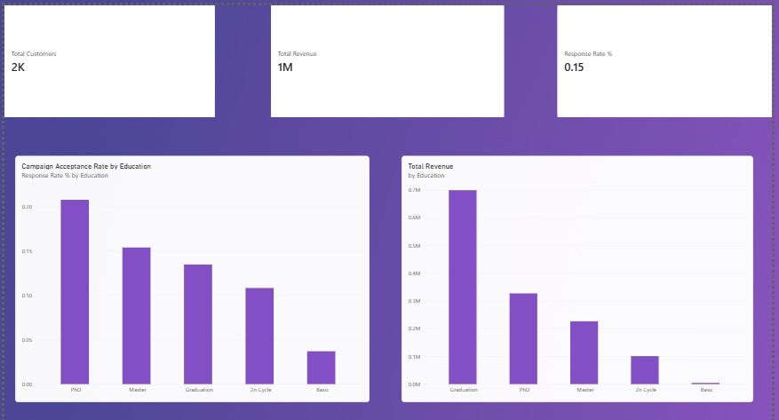

# Marketing Campaign & Customer Personality Analysis

## Overview
An end-to-end data analytics project examining customer demographics, multi-category spending habits, and promotional campaign response rates. The goal was to identify high-value customer segments and evaluate marketing ROI.

## Tech Stack
* **Python (Pandas):** Data cleaning, missing value imputation, and feature engineering (`Total_Spent`).
* **SQL (SQLite):** Exploratory data analysis and campaign response metric extraction.
* **Power BI:** Interactive executive dashboard design and visual storytelling.

## Key Insights
* **Revenue Drivers:** Customers with a Graduation degree drive the highest overall spending volume.
* **Campaign Response:** PhD holders exhibit the highest campaign acceptance rate despite comprising a smaller segment volume.

## Dashboard Preview

